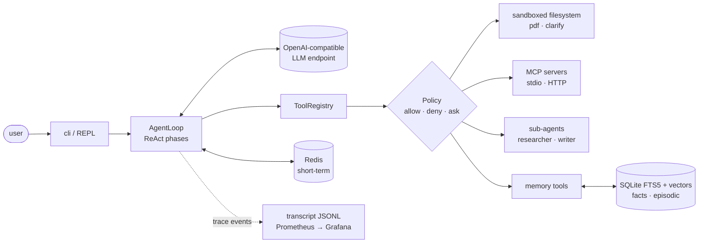

# Agent Harness

A terminal AI agent built from scratch in Python, with no agent framework. It is a ReAct loop with a sandboxed filesystem, three layers of memory, MCP tool servers, an allow/deny/ask permission policy, sub-agents that can run in parallel, and trace-driven observability with Prometheus and Grafana.


```
you> Research how MCP servers handle authentication and have the writer
     put a summary in reports/mcp-auth.md.
```

## Highlights

- **Hand-written ReAct loop.** Each turn runs through explicit phases: `fit_context → recall → act → response_check → finalize`. If the model claims it ran a tool, the claim is checked against the transcript rather than trusted.
- **Three-layer memory.**
  - *Short-term*: the live conversation, stored in Redis, with token-budgeted compaction.
  - *Long-term facts*: SQLite with hybrid search (FTS5 keyword search plus embeddings).
  - *Episodic*: a searchable archive of every past conversation.
  - Background consolidation pulls facts out of old turns and archives stale ones. Nothing is ever deleted.
- **MCP client from scratch.** JSON-RPC over stdio and streamable HTTP, built without an SDK. Tools from each server are namespaced as `server__tool`, and a server that fails to start is skipped instead of crashing the harness.
- **Permissions in one place.** Every MCP server connection and every tool call goes through the same allow / deny / ask policy, which matches tool names against globs. When no terminal is attached, `ask` becomes deny.
- **Sub-agents.**
  - A `researcher` (web search, no filesystem) and a `writer` (filesystem, no search). Each has its own tools, iteration limit and permissions.
  - A sub-agent can only delegate one level deep, can read memory but not write it, and can run in parallel with the others.
- **Skills.** Procedures written as Markdown (`SKILL.md`). Their names go into the system prompt, and the agent reads the full text only when a task needs it.
- **Observability.**
  - Every step of a run emits a structured trace event, and each run is saved as a JSONL transcript.
  - The same events feed Prometheus metrics and a pre-built Grafana dashboard. Secrets are redacted before anything is written.
- **Engineering documentation.** 12 design docs, 8 invariants each enforced by a named test, and 19 ADRs (architecture decision records), each backed by a measurement or a failure.

## Architecture



See [docs/01_architecture.md](docs/01_architecture.md) for the full component diagram and a sequence diagram of one turn.

## Project structure

```
.
├── harness/
│   ├── cli.py              REPL and one-shot mode
│   ├── startup.py          builds a ready loop from config: metrics, Redis, memory, tools, MCP, sub-agents
│   ├── config.py           one validated dataclass per config block
│   ├── llm_client.py       OpenAI-compatible chat-completions client
│   ├── skills.py           SKILL.md loader and the skill__read tool
│   ├── interactive.py      editable TTY input and permission prompts
│   ├── agent/              loop, phases, context, prompt builder, sub-agents
│   ├── memory/             facts, episodic archive, compaction, consolidation, embeddings
│   ├── tools/              registry, sandbox, filesystem, PDF export, permissions, clarify
│   ├── mcp/                transport (stdio / HTTP), JSON-RPC client, provider
│   ├── mcp_servers/        a small bundled MCP server (extends the reference "everything" server)
│   └── observability/      event emitter, transcript writer, Prometheus metrics, console panels
├── skills/                 Markdown procedures the agent reads on demand
├── tests/                  end-to-end tests with a scripted LLM, plus fakes in conftest.py
├── docs/                   architecture, one doc per component, invariants, ADRs
├── observability/          Prometheus scrape config and Grafana provisioning and dashboard
├── config.yaml             model, memory, MCP servers, permissions, sub-agents
├── docker-compose.yml      harness, Redis, Brave Search MCP, Prometheus, Grafana
├── Dockerfile
└── .env.example
```

## Quick start (Docker Compose)

You need Docker with Compose and an API key for any **OpenAI-compatible** endpoint that serves `/chat/completions` (and `/embeddings` if you want semantic memory).

```bash
git clone https://github.com/fathi-belmkadem/Agent-harness.git
cd Agent-harness

# 1. The LLM key is mounted as a Docker secret, so it never shows up in env or `docker inspect`
mkdir -p .secrets
echo -n "your_api_key" > .secrets/agent_access_token.txt

# 2. Optional settings: endpoint override, Brave web search
cp .env.example .env
#   LLM_BASE_URL=https://your-endpoint/v1
#   BRAVE_API_KEY=...        (leave empty to skip web search)

# 3. Start the stack and attach to the REPL
docker compose up -d
docker compose attach agent-harness
```

```
· metrics: http://0.0.0.0:9100/metrics
· session: resumed 12 prior messages
· skills: mcp-report, remember-decisions
· everything: 13 tools
· brave-search: 8 tools
· sub-agents: researcher, writer
Agent ready. Type your task, or 'exit' / Ctrl-D to quit.

you>
```

- **Detach** with `Ctrl-P Ctrl-Q`. **Quit** with `exit`. `docker compose down` stops everything.
- **Grafana dashboard**: http://localhost:3000 (no login).
- **One-shot JSON run**: `docker compose run --rm --name agent-harness agent-harness --prompt "list the workspace" --json`
- **Fresh conversation**: add `--new-session`.

Set the model names in `config.yaml` (`llm.model`, `memory.embeddings.model`, `memory.consolidation.model`) to models your endpoint serves. If the embeddings endpoint is unavailable, memory search falls back to keyword-only.

### What persists

| Path | Contents |
|---|---|
| `workspace/` | the agent's sandbox: every file it reads or writes |
| `.memory/` | long-term facts and the episodic archive (SQLite) |
| `.transcripts/` | one JSONL trace per run |
| Redis volume | the live conversation, resumed on restart |

## Running the tests

```bash
python -m venv .venv && source .venv/bin/activate   # Windows: .venv\Scripts\activate
pip install -r requirements-dev.txt
pytest
```

The tests need no network, Redis or API key. Each core test drives one realistic task through `AgentLoop` with a scripted model and checks the invariants the task passes through along the way. The fake LLM, Redis, MCP server and embedder are in `tests/conftest.py`.

## Design decisions

Some of the decisions recorded in [docs/12_ADR.md](docs/12_ADR.md):

- **No agent framework** (ADR-001). The loop, the MCP client and the memory are all written by hand, so every behaviour is visible and testable.
- **Hybrid retrieval** (ADR-011). FTS5 handles exact identifiers and embeddings handle paraphrases. The similarity threshold was set from measurements on the project's own stored facts.
- **User messages are never compacted** (ADR-008). Only the middle of the conversation is summarised. The opening messages and the recent tail stay word for word.
- **Tool claims are checked** (ADR-017). If the model says it did something, the transcript must show the matching tool call.
- **Metrics come from the trace** (ADR-020). Prometheus is just a second consumer of the same trace events, so the loop has no metrics code of its own.

## Documentation

| Doc | Topic |
|---|---|
| [01 Architecture](docs/01_architecture.md) | components, one turn as a sequence diagram, deployment |
| [02 ReAct loop](docs/02_react-loop.md) · [03 Context](docs/03_context.md) · [04 Tools](docs/04_tools.md) | the core loop |
| [05 MCP](docs/05_mcp.md) · [06 Memory](docs/06_memory.md) · [07 Permissions](docs/07_permissions.md) | subsystems |
| [08 Sub-agents](docs/08_subagents.md) · [09 Interactive](docs/09_interactive.md) · [10 Observability](docs/10_observability.md) | subsystems |
| [11 Invariants](docs/11_invariants.md) | 8 rules the harness must not break, each tied to a test |
| [12 ADRs](docs/12_ADR.md) | the decisions in force and the evidence behind them |

## Credits

Built as a team project for the AI Engineering Lab at the University of Passau (summer semester 2026) by **Fathi Belmkadem**, **Ruixin He** and **Abdelrahman Ashraf**.
