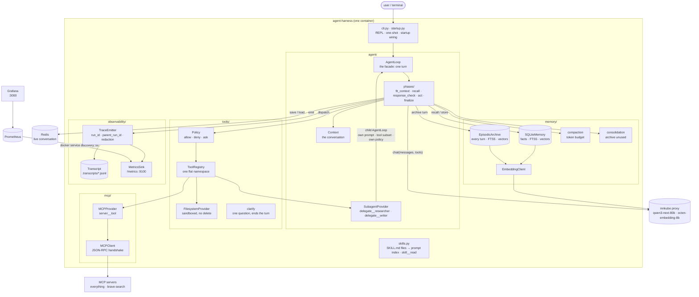
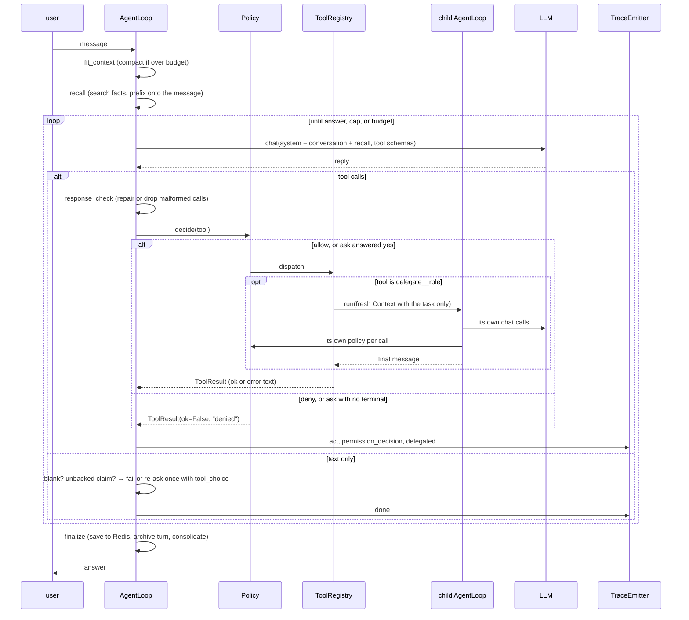
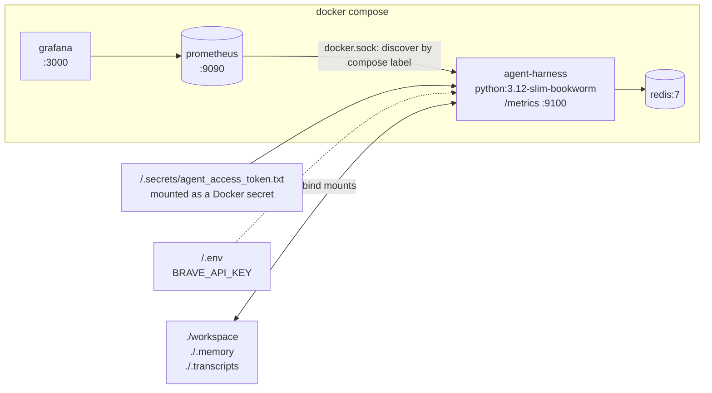

# Architecture

The system as it stands at the end of week 3. Two diagrams: the components
and how they connect, then one turn as it actually executes. Both render on
GitHub; the source is Mermaid, so a change to the code is a change to a few
lines here.

## Components

What changed this week, in the diagram: the `Policy` box in front of the
registry, the `SubagentProvider` that builds a second `AgentLoop`, and the
`MetricsSink` beside the transcript with Prometheus and Grafana behind it.
None of the three required a change to `AgentLoop` or to any phase; each
plugs into a seam that already existed — the one dispatch function, the
provider protocol, the emitter.

## One turn

## Where each component is documented

| component | doc |
|---|---|
| the loop and its phases | [02_react-loop.md](02_react-loop.md) |
| context and compaction | [03_context.md](03_context.md) |
| tools, registry, sandbox | [04_tools.md](04_tools.md) |
| MCP | [05_mcp.md](05_mcp.md) |
| memory: facts, episodic, consolidation | [06_memory.md](06_memory.md) |
| permissions | [07_permissions.md](07_permissions.md) |
| sub-agents | [08_subagents.md](08_subagents.md) |
| observability | [10_observability.md](10_observability.md) |

## Deployment

`docker compose run --rm --name agent-harness agent-harness` starts all four. The token never
appears in a shell command or an environment listing; the three bind mounts
are what make output, memory and traces visible on the host.
